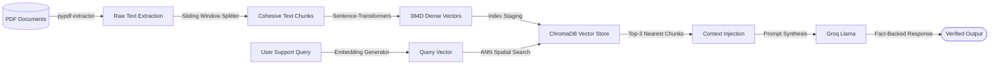

# 🎙️ AI Customer Support Voice Agent

[](https://www.python.org/)
[](https://fastapi.tiangolo.com/)
[](https://console.groq.com/)
[](https://www.trychroma.com/)
[](https://sqlite.org/)
[](https://huggingface.co/sentence-transformers)
[](https://react.dev/)

A production-grade AI Customer Support backend with an integrated **Voice AI pipeline** powered by **Groq Whisper Large V3 Turbo** (speech-to-text), the **Groq Llama** language model (reasoning), and **Browser SpeechSynthesis** (voice output). The system coordinates intent routing, local semantic document retrieval (RAG) with ChromaDB, and parameterized SQL queries to resolve customer support inquiries end-to-end.

---

## 🎯 Project Overview

This project implements a full-stack AI Customer Support Agent with voice capabilities. It handles user text and voice inquiries by dynamically routing them based on semantic intent:

- **Transactional queries** (e.g., "Where is my order #1002?") → resolved via parameterized SQLite queries
- **Informational queries** (e.g., "What is your return policy?") → answered via RAG pipeline querying ChromaDB
- **Voice input** → transcribed via Groq Whisper, then routed through the same agent pipeline
- **Voice output** → spoken client-side via the Browser SpeechSynthesis API

### 🌟 Key Highlights for Recruiters

- **Voice AI Pipeline**: Full audio → STT → NLP → TTS pipeline using only Groq APIs + browser native APIs
- **Production-Ready Engineering**: Pydantic validation, structured JSON error responses, thread-pool offloading
- **100% Local Vector Compute**: Sentence-Transformers + ChromaDB with zero external embedding dependencies
- **Modular Architecture**: Each concern is isolated — `voice.py`, `agent.py`, `rag.py`, `database.py` are fully independent
- **Secure SQL**: Parameterized queries prevent SQL injection throughout

---

## 🏗️ Voice Architecture

### Complete Voice Request Flow

```
Customer
    │
    ▼
React Chat UI (Minimal)
    │
    ▼
MicButton (MediaRecorder API)
    │  audio/webm blob
    ▼
POST /voice  (multipart/form-data)
    │
    ▼
voice.py
    │  validates format, writes temp file
    ▼
Groq Whisper Large V3 Turbo
    │  (whisper-large-v3-turbo)
    ▼
Transcribed Text
    │
    ▼
process_customer_query()  [agent.py — UNCHANGED]
    ┌──────────────────┐
    ▼                  ▼
SQLite            RAG + ChromaDB
(order queries)   (knowledge queries)
    └──────┬───────────┘
           ▼
       Groq Llama
       (llama3-8b-8192)
           ▼
    ChatResponse JSON
           │  response text
           ▼
Browser SpeechSynthesis API
           │
           ▼
  User Hears the Response
```

### Voice Module Responsibilities (`voice.py`)

| Responsibility | Implementation |
|---------------|----------------|
| Receive audio bytes | `transcribe_audio(file_bytes, content_type, filename)` |
| Validate format | MIME type allowlist (webm, ogg, wav, mp4, m4a, mp3) |
| Validate non-empty | Size guard (must be ≥ 1 KB) |
| Call Groq Whisper | `groq_client.audio.transcriptions.create()` |
| Handle errors | Typed `VoiceTranscriptionError` with HTTP status codes |
| Log every stage | Structured logger: received → validated → whisper → complete |
| Cleanup | Temp file deleted in `finally` block |

---

## 🛠️ Tech Stack

| Layer | Technology | Purpose |
|-------|-----------|---------|
| Frontend | React 19 + Vite | Minimal chat UI |
| Voice Input | Browser MediaRecorder API | Audio capture |
| Voice Output | Browser SpeechSynthesis API | Text-to-speech playback |
| Backend | FastAPI + Uvicorn | REST API server |
| STT | Groq Whisper Large V3 Turbo | Speech-to-text |
| LLM | Groq Llama (llama3-8b-8192) | Natural language responses |
| Vector DB | ChromaDB | Local semantic search |
| Embeddings | Sentence Transformers (all-MiniLM-L6-v2) | 384-dim local embeddings |
| Relational DB | SQLite | Order ledger |
| PDF Processing | PyPDF | Document ingestion for RAG |

---

## 📂 Folder Structure

```
ai-support-agent/
├── backend/
│   ├── agent.py          # Intent routing, system prompt, Groq Llama orchestration
│   ├── database.py       # SQLite layer: seed data, parameterized CRUD
│   ├── embeddings.py     # Sentence-Transformers local embedding generator
│   ├── main.py           # FastAPI app: /chat, /voice, /health endpoints + CORS
│   ├── models.py         # Pydantic schemas: ChatRequest, ChatResponse, ErrorResponse
│   ├── rag.py            # PDF parsing, chunking, ChromaDB client
│   ├── tools.py          # Agent tool registry and OpenAI-style tool schemas
│   ├── voice.py          # [NEW] Groq Whisper transcription module
│   └── orders.db         # SQLite database (auto-generated)
├── chroma_db/            # ChromaDB persistent vector index (auto-generated)
├── data/
│   ├── faq.pdf           # Return policy & FAQ content
│   ├── manual.pdf        # Product setup & troubleshooting
│   └── policy.pdf        # Shipping & warranty policies
├── frontend/
│   └── src/
│       ├── App.jsx       # [UPDATED] Minimal chat UI with inline MicButton
│       ├── index.css     # Design system and component styles
│       └── main.jsx      # React entry point
├── .env                  # Environment secrets (git-ignored)
├── .gitignore
├── requirements.txt      # Python dependencies
└── README.md
```

---

## ⚙️ Installation & Setup

### 1. Clone the Repository
```bash
git clone https://github.com/your-username/ai-support-agent.git
cd ai-support-agent
```

### 2. Configure a Python Virtual Environment
```bash
# Windows
python -m venv .venv
.venv\Scripts\activate

# macOS / Linux
python3 -m venv .venv
source .venv/bin/activate
```

### 3. Install Python Dependencies
```bash
pip install -r requirements.txt
```

### 4. Configure Environment Variables
Create a `.env` file in the project root:
```ini
GROQ_API_KEY=your_groq_api_key_here
```
Get your key at [console.groq.com/keys](https://console.groq.com/keys).

### 5. Seed the Databases
Initialize SQLite orders and build the ChromaDB vector index:
```bash
python backend/database.py   # Creates orders.db with sample orders
python backend/rag.py        # Processes PDFs → ChromaDB embeddings
```

### 6. Start the Backend
```bash
uvicorn backend.main:app --reload
```
The API is now live at `http://localhost:8000`.  
Interactive docs available at `http://localhost:8000/docs`.

### 7. Start the Frontend
```bash
cd frontend
npm install
npm run dev
```
The chat UI is at `http://localhost:5173`.

---

## 🔒 Environment Variables

| Variable | Description | Required |
|----------|-------------|----------|
| `GROQ_API_KEY` | API key for Groq cloud inference (Whisper + Llama) | ✅ Required |

---

## ⚡ API Endpoints

### `GET /health`
Health check used by load balancers and monitoring tools.

**Response (200 OK)**:
```json
{
  "status": "healthy",
  "version": "1.0.0",
  "timestamp": "2026-07-17T10:30:00.123456"
}
```

---

### `POST /chat`
Text-based chat endpoint. Accepts a user message, routes it through the AI agent, returns a response.

**Request Body**:
```json
{
  "message": "Where is my order 1002?",
  "session_id": "sess_abc123",
  "language": "en"
}
```

**Response (200 OK)**:
```json
{
  "response": "Your order #1002 has been shipped. It's expected to arrive by July 5th.",
  "session_id": "sess_abc123",
  "sources": ["SQLite Database (Order Ledger)"],
  "timestamp": "2026-07-17T10:30:05.987654"
}
```

---

### `POST /voice`
**Voice pipeline endpoint.** Accepts a recorded audio file, transcribes it with Groq Whisper, passes the transcription to the AI agent, and returns a natural language response.

**Request**: `multipart/form-data`

| Field | Type | Description |
|-------|------|-------------|
| `audio` | File | Recorded audio (webm, ogg, wav, mp4, m4a, mp3) |

**Supported audio formats**: `audio/webm`, `audio/ogg`, `audio/wav`, `audio/mp4`, `audio/x-m4a`, `audio/mpeg`

**Response (200 OK)**:
```json
{
  "response": "Your order #1002 has been shipped and is expected by July 5th.",
  "session_id": null,
  "sources": ["SQLite Database (Order Ledger)"],
  "timestamp": "2026-07-17T10:30:07.123456"
}
```

**Error Responses**:

| Status | Condition |
|--------|-----------|
| `400` | Empty or corrupt recording |
| `415` | Unsupported audio format |
| `422` | No speech detected in audio |
| `502` | Groq Whisper API failure |
| `503` | Groq client not initialized |

---

## 🧠 Voice Logging

Every voice request logs the following structured events:

```
2026-07-17 10:30:00 | INFO     | backend.voice | Voice request received | filename='recording.webm' | content_type='audio/webm' | size=48320 bytes
2026-07-17 10:30:00 | INFO     | backend.voice | Audio validation passed | normalized_type='audio/webm' | extension='.webm'
2026-07-17 10:30:00 | INFO     | backend.voice | Submitting audio to Groq Whisper API (model: whisper-large-v3-turbo)...
2026-07-17 10:30:01 | INFO     | backend.voice | Whisper transcription successful | duration=0.94s | text='Where is my order 1002?'
2026-07-17 10:30:01 | INFO     | backend.voice | Voice pipeline complete | total_time=1.12s | transcript_length=29 chars
2026-07-17 10:30:01 | INFO     | backend.main  | Voice pipeline complete | agent_time=1.83s | total_time=2.95s | sources=['SQLite Database']
```

---

## 🧠 RAG Workflow



1. **Extraction**: `PdfReader` extracts text from PDFs in `/data`.
2. **Chunking**: 500-character segments with 50-character sliding overlap.
3. **Embeddings**: `all-MiniLM-L6-v2` projects text into 384-dimensional vectors.
4. **Indexing**: Vectors stored in ChromaDB (persistent disk storage).
5. **Retrieval**: ANN query returns top-3 semantically relevant chunks.
6. **Augmentation**: Chunks injected into the Groq Llama system prompt.

---
